# Hi, I'm Anas

Fullstack engineer from Kerala, India. I build products end to end: storefronts, dashboards, mobile apps, and the backends and infra behind them. Right now I'm a software engineer at [Libay](https://libay.in).

On the side I try out AI tools and new tech, and build fun things like Discord bots and mini games.

The banner is [my portfolio](https://anasp.in) in five of its themes. Go pick your favourite.

### Tools I reach for

TypeScript · React · Next.js · React Native · Node.js · PostgreSQL · MongoDB · Redis · Go · Linux

### Say hi

[anasp.in](https://anasp.in) · [LinkedIn](https://www.linkedin.com/in/anaspappadan) · [anaspworkmail@gmail.com](mailto:anaspworkmail@gmail.com)
